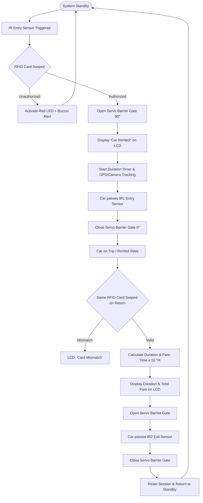

# 🚗 Smart Car Rental System

[](https://www.bracu.ac.bd/)
[](https://www.arduino.cc/)
[](#license)

An automated, IoT-enabled **Smart Car Rental Prototype** developed as the term project for **CSE461: Introduction to Robotics** at **BRAC University**. 

The system automates the vehicle rental workflow with zero human operator dependency. It features **RFID authentication**, **automated barrier gates**, **infrared vehicle direction tracking**, **real-time billing and LCD cost calculation**, **stepper-driven camera pan surveillance**, and **GPS vehicle tracking**.

---

## 👥 Project Team (Group 05, Section 08)

| Name | Student ID | Primary Responsibilities |
| :--- | :---: | :--- |
| **Md Rakibul Hasan** | 22101326 | Stepper Motor (28BYJ-48 + Potentiometer), UBLOX NEO-6M GPS integration, IR1/IR2 logic, GeoLinker API telemetry |
| **Md. Ahnaf Iqbal** | 22101706 | RFID SPI integration, I2C LCD interfacing, PWM Servo barrier control, unauthorized alarm logic, system architecture |
| **Argha Basak** | 22101398 | ESP32-CAM live Wi-Fi video streaming server, debugging and camera web portal integration |
| **Lamia Alam Emu** | 21301662 | UID verification logic, rental timer & fare calculation, LED/Buzzer sync, physical chassis assembly |

---

## 📌 Key Features

1. **RFID Contactless Authentication**:
   - Authorized cards open the gate and instantly initiate a rental session.
   - Unauthorized cards trigger an immediate audio-visual alarm (triple buzzer beep + flashing red LED).
2. **Automated Barrier Gate (Servo SG90)**:
   - Barrier opens to $90^\circ$ on valid authentication or completed payment.
   - Automatically closes ($0^\circ$) once the vehicle safely passes the infrared detection point.
3. **Dual IR Vehicle Passage Sensing**:
   - `IR1 (Entry Sensor)`: Detects car entering the facility and triggers gate closure.
   - `IR2 (Exit Sensor)`: Detects car exiting after rental termination.
4. **Transparent Real-Time Billing & LCD Interface**:
   - Logs start timestamp using `millis()`.
   - Computes total rental duration upon return and calculates fare:  
     $$\text{Fare (TK)} = \text{Duration (seconds)} \times 10$$
   - Displays duration and fare on a $16 \times 2$ I2C Liquid Crystal Display.
5. **Secondary Stepper Pan Surveillance Camera**:
   - 28BYJ-48 Stepper motor + ULN2003 driver controlled by a $10\text{ k}\Omega$ potentiometer.
   - Provides smooth, manual pan control of the surveillance camera across the docking bay.
   - Powered on a dedicated secondary Arduino Uno to prevent SPI conflicts and power drops.
6. **Live ESP32-CAM Video Feed**:
   - Streams real-time MJPEG video over 2.4 GHz local Wi-Fi to a web browser for dock security.
7. **NEO-6M GPS Fleet Tracking**:
   - Tracks live latitude, longitude, and speed using an ESP32 micro-controller and sends telemetry to the cloud.

---

## 🏗️ System Architecture & Workflow



---

## 🎥 Project Demonstration Video

Watch the complete hardware prototype in action (RFID scanning, gate actuation, IR detection, LCD billing, and camera tracking):

▶️ **[Click here to view / download the Demo Video (MP4)](docs/Smart_Car_Rental_Demo_Video.mp4)**

---

## 🔌 Hardware Pinout & Wiring Guide

### 1. Main Controller — Arduino Uno R3 #1 (Rental & Access Gate)

| Component | Pin on Module | Arduino Uno Pin | Note |
| :--- | :--- | :--- | :--- |
| **RFID-RC522** | SDA (SS) | **Digital 10** | SPI Slave Select |
| | SCK | **Digital 13** | SPI Clock |
| | MOSI | **Digital 11** | SPI Master Out |
| | MISO | **Digital 12** | SPI Master In |
| | RST | **Digital 7** | Reset pin |
| | 3.3V | **3.3V** | ⚠️ *Do NOT connect to 5V (damages chip)* |
| | GND | **GND** | Ground |
| **I2C LCD 16x2** | SDA | **Analog A4** | I2C Data |
| | SCL | **Analog A5** | I2C Clock |
| | VCC | **5V** | Power |
| | GND | **GND** | Ground |
| **SG90 Servo** | Signal (Orange/Yellow) | **Digital 9 (PWM)** | $0^\circ$ Locked, $90^\circ$ Unlocked |
| | VCC (Red) | **5V** | External/Arduino 5V |
| | GND (Brown) | **GND** | Ground |
| **IR Sensor 1 (Entry)** | OUT | **Digital 2** | Active LOW on obstacle |
| **IR Sensor 2 (Exit)** | OUT | **Digital 3** | Active LOW on obstacle |
| **Green Indicator LED** | Anode (+) | **Digital 4** | Via $220\,\Omega$ resistor |
| **Red Indicator LED** | Anode (+) | **Digital 5** | Via $220\,\Omega$ resistor |
| **Buzzer** | Positive (+) | **Digital 6** | Ground to Arduino GND |

---

### 2. Camera Pan Mount — Arduino Uno R3 #2 (Stepper & Potentiometer)

*Dedicated board to prevent power fluctuations and SPI pin conflicts.*

| Component | Module Pin | Arduino Uno Pin | Note |
| :--- | :--- | :--- | :--- |
| **ULN2003 Stepper Driver** | IN1 | **Digital 8** | Phase A |
| | IN2 | **Digital 9** | Phase B |
| | IN3 | **Digital 10** | Phase C |
| | IN4 | **Digital 11** | Phase D |
| | VCC / GND | **5V / GND** | External 5V supply recommended |
| **10kΩ Potentiometer** | Wiper (Center) | **Analog A0** | Analog input $0 - 1023$ |
| | Outer Pin 1 / 2 | **5V / GND** | Reference voltage |

---

### 3. Fleet GPS Tracking — ESP32 WROOM

| UBLOX NEO-6M GPS Pin | ESP32 Pin | Function |
| :--- | :--- | :--- |
| **VCC** | **3.3V / 5V** | Module Power |
| **GND** | **GND** | Common Ground |
| **TX** | **GPIO 16 (RX2)** | Hardware UART2 Receive |
| **RX** | **GPIO 17 (TX2)** | Hardware UART2 Transmit |

---

### 4. Live Dock Surveillance — ESP32-CAM

Uses standard AI-Thinker pin configuration with on-board OV2640 camera module. Connects to 2.4 GHz local Wi-Fi and provides an HTTP stream at port 80.

---

## 📦 Bill of Materials (BOM) & Budget

| No | Component | Quantity | Unit Cost (BDT) | Total Cost (BDT) |
| :---: | :--- | :---: | :---: | :---: |
| 1 | Arduino Uno R3 | 2 | 500 | 1000 |
| 2 | ESP32-CAM Module with OV2640 | 1 | 890 | 890 |
| 3 | UBLOX NEO-6M GPS Module | 1 | 440 | 440 |
| 4 | RFID-RC522 Module + RFID Cards | 1 | 195 | 195 |
| 5 | 28BYJ-48 5V Stepper + ULN2003 | 1 | 230 | 230 |
| 6 | SG90 Micro Servo Motor | 1 | 135 | 135 |
| 7 | 16x2 I2C LCD Screen | 1 | 600 | 600 |
| 8 | IR Obstacle Avoidance Sensors | 2 | 50 | 100 |
| 9 | 10kΩ Potentiometer, LEDs, Buzzer | 1 set | 100 | 100 |
| 10 | Breadboard & Jumper Wires | 1 set | 155 | 155 |
| 11 | Power Supply / Battery Pack | 3 | 95 | 275 |
| **Total** | | | | **~4,100 TK** |

---

## 📁 Repository Structure

```
.
├── Main_Rental_System/
│   └── Main_Rental_System.ino             # Primary controller (RFID, Gate, LCD, Fare)
├── Stepper_Camera_Mount/
│   └── Stepper_Camera_Mount.ino           # Secondary controller (Stepper + 10k Pot)
├── ESP32_GPS_Tracker/
│   └── ESP32_GPS_Tracker.ino              # Fleet location tracking (NEO-6M + WiFi)
├── ESP32_CAM_Surveillance/
│   └── ESP32_CAM_Surveillance.ino         # Live Wi-Fi video streaming server
├── RFID_UID_Scanner_Helper/
│   └── RFID_UID_Scanner_Helper.ino        # Helper sketch to read & format card UIDs
├── docs/
│   ├── Smart_Car_Rental_System_Report.pdf # Complete CSE461 Lab Project Report
│   └── Smart_Car_Rental_Demo_Video.mp4    # Working physical prototype demonstration
├── .gitignore                             # Git ignore rules for embedded builds
└── README.md                              # Complete Project documentation
```

---

## 🚀 Getting Started

### 1. Arduino IDE Setup & Required Libraries

Install the latest version of [Arduino IDE](https://www.arduino.cc/en/software). Install the following libraries via **Tools > Manage Libraries...**:

- `MFRC522` by GithubCommunity
- `LiquidCrystal_I2C` by Frank de Brabander
- `Servo` (Built-in)
- `Stepper` (Built-in)
- `TinyGPSPlus` by Mikal Hart
- `WiFi` (Included in ESP32 board support package)

For ESP32 boards, add the ESP32 board manager URL in **File > Preferences**:
```
https://raw.githubusercontent.com/espressif/arduino-esp32/gh-pages/package_esp32_index.json
```

---

### 2. Reading Your RFID Card UIDs

1. Open `RFID_UID_Scanner_Helper/RFID_UID_Scanner_Helper.ino` in Arduino IDE.
2. Flash it to your Arduino Uno connected to the RC522 module.
3. Open **Tools > Serial Monitor** at `9600 baud`.
4. Tap your RFID cards / keyfobs. The serial monitor will output the exact byte array:
   ```cpp
   Code snippet for AUTHORIZED_CARDS: {0xDE, 0xAD, 0xBE, 0xEF}
   ```
5. Copy this array into the `AUTHORIZED_CARDS` list in `Main_Rental_System_Arduino.ino`.

---

### 3. Flashing the Main Controller

1. Open `Main_Rental_System/Main_Rental_System.ino`.
2. Connect the primary Arduino Uno. Select the correct COM port and board (**Arduino Uno**).
3. Click **Upload**.
4. Test by tapping an authorized card:
   - Green LED turns on.
   - Servo opens to $90^\circ$.
   - LCD displays `Car Rented! / Drive Safe!`.
   - Gate closes as the car clears the IR sensor.
5. Tap the same card again to simulate car return:
   - LCD displays total elapsed seconds and calculated fare in TK.
   - Servo opens to allow exit.

---

### 4. Running the Stepper Camera Pan Mount

1. Open `Stepper_Camera_Mount/Stepper_Camera_Mount.ino`.
2. Connect the secondary Arduino Uno.
3. Upload the sketch and rotate the $10\text{ k}\Omega$ potentiometer to verify continuous pan adjustment of the camera mount.

---

### 5. Running the ESP32-CAM Live Video Stream

1. Open `ESP32_CAM_Surveillance/ESP32_CAM_Surveillance.ino`.
2. Enter your 2.4 GHz Wi-Fi SSID and Password:
   ```cpp
   const char* ssid = "YOUR_WIFI_SSID";
   const char* password = "YOUR_WIFI_PASSWORD";
   ```
3. Connect **GPIO 0 to GND** on ESP32-CAM to enter flashing mode.
4. Select Board: **AI Thinker ESP32-CAM**.
5. Upload the code. Disconnect GPIO 0 from GND and hit the **RST** button.
6. Open Serial Monitor at `115200 baud` to obtain the assigned local IP (e.g., `10.99.64.228`).
7. Open `http://<YOUR_ESP32_IP>` on any phone or browser connected to the same Wi-Fi network.

---

### 6. Running the GPS Tracker

1. Open `ESP32_GPS_Tracker/ESP32_GPS_Tracker.ino`.
2. Enter Wi-Fi credentials and GeoLinker / telemetry credentials.
3. Select board **ESP32 Dev Module** and upload.
4. *Note on GPS Satellite Fix:* As noted in our project report, GPS modules require an open sky view to acquire at least 4 satellite signals. Testing indoors will output `Invalid NMEA` status check messages until placed near a window or outdoors.

---

## 🛠️ Challenges Faced & Solutions

1. **Power Consumption & Brownouts**:
   - The 28BYJ-48 stepper motor draws significant current when holding position. Powering it alongside the servo and RFID from a single Arduino caused voltage drops and microcontroller resets.
   - **Solution**: Segregated the stepper motor and manual pan potentiometer to a dedicated secondary Arduino board with isolated power.
2. **SPI Pin Conflicts**:
   - The MFRC522 RFID reader requires SPI hardware pins (Digital 11, 12, 13). Reusing these pins on a single board for other actuators caused communication hang-ups.
   - **Solution**: The two-board architecture completely resolved hardware bus collisions.
3. **Indoor GPS Satellite Lock**:
   - Indoor building ceilings attenuate satellite signals, producing NMEA checksum failures.
   - **Solution**: Implemented strict diagnostic status logging (`STATUS_GPS_PARSE_ERROR`) verifying that hardware UART is functional while awaiting satellite lock outdoors.

---

## 📜 References

- Krisna, R. (2025). *How to build a simple GPS Tracker using ESP32 and Visualize Data on Map*. CircuitDigest.
- Robojax (2022). *How to setup and use ESP32 Cam with Micro USB WiFi Camera*. YouTube.
- DIY Engineers (2021). *Arduino RFID module RC522 - how to use*. YouTube.
- Tech Talkies (2024). *Beginner Stepper motor for Arduino projects*. YouTube.

---

## 📄 License

This project was developed for educational purposes under the CSE461 curriculum at BRAC University. Distributed under the MIT License.
